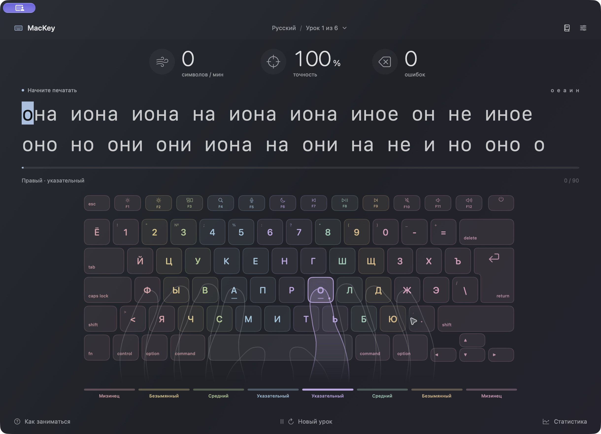

# MacKey

Нативный клавиатурный тренажёр для macOS на Swift и SwiftUI. Полная экранная клавиатура с функциональным рядом F1–F12, отдельным пастельным цветом каждого пальца, полупрозрачными клавишами и векторными подсказками рук.

Мягкое стеклянное оформление всех окон: нативный Liquid Glass в macOS 26 и новее, полупрозрачный материал в macOS 14–15. При уменьшении прозрачности или повышенном контрасте используется непрозрачный фон. Цветовые подсказки и текст сохраняют читаемость.

## Скачать приложение

[MacKey 1.0.3 для Apple Silicon](https://github.com/zel0th/MacKey/releases/tag/v1.0.3) — готовое приложение для macOS 14 и новее. Распакуйте ZIP и перенесите MacKey.app в «Программы». При обновлении закройте MacKey и замените предыдущую версию: настройки, библиотека и история сохраняются.

Сборка подписана локальной подписью ad hoc и не нотариализована Apple. Инструкция первого запуска и контрольная сумма находятся в описании релиза.

Для стандартного предупреждения «приложение загружено из Интернета» вместо блокировки Gatekeeper при обычных настройках macOS нужны сертификат **Developer ID Application** из Apple Developer Program и нотариализация Apple. Локальная подпись и смена ZIP на DMG этого не заменяют. Подробности: [первый запуск приложений](https://support.apple.com/en-ie/102445), [подпись Developer ID](https://developer.apple.com/developer-id/). Текущий релиз не заявлен как нотариализованный.

## Как создан проект

Приложение **полностью написано с помощью OpenAI Codex (ChatGPT)** по идее, требованиям и обратной связи автора проекта. ИИ-ассистент подготовил весь исходный код на Swift, интерфейс, векторную графику, тесты, документацию и проект Xcode. Автор задавал направление разработки и проверял результат.

## Открыть в Xcode

1. Откройте `MacKey.xcodeproj`.
2. Выберите схему **MacKey**, устройство **My Mac** и нажмите **Run (⌘R)**. Тесты запускаются через **⌘U**.
3. Для локального запуска используется подпись **Sign to Run Locally**. Для распространения выберите свою команду Apple Developer в Signing & Capabilities и выполните Archive / notarization.

Требования: **macOS 14+**, **Xcode 16+ / Swift 6**. Внешних библиотек и загрузок зависимостей нет. Поддерживаются Apple Silicon и Intel при сборке соответствующей архитектуры в Xcode.

`Package.swift` позволяет открыть исходники и тесты как Swift Package. Проверка ядра: `bash Scripts/test.sh`. Интеграционные проверки macOS: `bash Scripts/check-layouts.sh` и `bash Scripts/check-store.sh`. Воспроизводимые замеры проверки длинных текстов и сохранения: `bash Scripts/check-performance.sh`. Сборка `.app` и ZIP для релиза без полного Xcode при наличии Command Line Tools: `bash Scripts/build-app.sh`.

## Возможности

- Шесть уровней от частых букв к полному алфавиту; автоматический или ручной выбор.
- Подбор слов с повышенной вероятностью проблемных букв по последним 30 завершённым занятиям выбранного языка и раскладки.
- Автоматическое повышение: два результата подряд от 96% и 100 сим/мин; понижение при точности ниже 85%.
- Экспертный режим без подсказок, заглавные буквы, числа, пунктуация, выбор длины упражнения.
- Три варианта обработки ошибок: повторить верную клавишу, исправить Delete, продолжить с ошибкой.
- 11 языков: русский, английский, украинский, немецкий, французский, испанский, португальский, итальянский, греческий, турецкий, монгольский.
- Встроенные русская, украинская, QWERTY, Dvorak, Colemak; дополнительные раскладки читаются из таблиц macOS, включая их Shift/Option-слои. Доступность зависит от установленной версии macOS. Системный источник ввода не изменяется.
- Физическая клавиатура ANSI / ISO, F1–F12, Esc, системные клавиши, перевёрнутый T-блок стрелок и L-образный ISO Return.
- Крупный текст 40 пт по умолчанию, настройка до 48 пт. Две строки на экране, автоматическая смена страниц без прокрутки текста; возврат через Delete сохраняет нужную страницу.
- Плавные полупрозрачные контуры рук поверх клавиатуры. Активный палец подсвечивается цветом своей зоны. Руки сохраняют естественную исходную позу и не деформируются при смене клавиш.
- По умолчанию выбрана **Русская — Mac (ЙЦУКЕН)**. Она также выбирается при переключении языка на русский; ранее сохранённый явный выбор раскладки остаётся доступен. Русские раскладки явно различаются как Mac / ПК (ЙЦУКЕН) и фонетическая QWERTY; встроенный вариант отмечен отдельно.
- Подсказки клавиш и пальцев, скрытие клавиатуры, звук ошибки, светлая / тёмная / системная тема.
- Светлая тема использует отдельную насыщенную палитру символов, пастельную заливку клавиш и усиленный контур активного пальца; тёмная сохраняет мягкие светлые акценты.
- Скорость в символах или условных словах (5 символов) в минуту, точность, ошибки, прогресс.
- Статистика без вертикальной прокрутки: обзор с графиком, рекордами и звёздами; клавиши по 24 на страницу; история по 8 занятий на страницу и подробности результата. Скорость во всех разделах использует выбранные сим/мин или слов/мин. Экспорт CSV сохраняет все раскладки.
- Справка «Как заниматься» с тремя вкладками: первые шаги, обучение и горячие клавиши. Весь текст каждой вкладки помещается в окно.
- Собственные тексты: редактор, вставка, импорт UTF-8 TXT, библиотека. До 50 000 символов на упражнение. Пробельные последовательности нормализуются.
- Пауза при потере фокуса и открытии панелей, локальное атомарное сохранение JSON.
- Ввод перехватывается **только внутри активного окна приложения**; разрешение на глобальное отслеживание клавиатуры не требуется.

## Управление

| Действие | Клавиши |
|---|---|
| Новая строка / урок | Return или ⌘R |
| Пауза / продолжение | Esc или ⌘P |
| Исправление | Delete |
| Настройки | ⌘, |
| Собственные тексты | ⌘O |
| Статистика | ⌘⇧S |
| Полный экран | ⌃⌘F |

F1–F12 отображаются и подсвечиваются при получении обычных F-событий. В зависимости от настроек macOS понадобится Fn. Системные функции яркости, Mission Control и громкости не перехватываются. Клавиша питания является визуальной частью схемы.

## Архитектура

- `Sources/MacKeyCore`: независимый движок набора, модели, генерация уроков, геометрия и раскладки.
- `Sources/MacKey`: SwiftUI-интерфейс, AppKit-ввод в окне, системные раскладки Carbon, сохранение, Swift Charts.
- `Tests/MacKeyCoreTests`: Swift Testing, детерминированное время и генератор случайных чисел.
- `Design`: иконка приложения и редактируемые векторные материалы.
- `Scripts/generate-project.py`: воспроизводимое создание `.xcodeproj` после добавления файлов.
- `Documentation`: функциональное соответствие и результаты проверки.

Контуры клавиш и рук заданы SwiftUI `Shape` / `Path`; заливка и рамка клавиш рисуются векторными слоями Core Animation, текст — системным векторным шрифтом. Они остаются резкими на Retina и при масштабировании; растровые изображения клавиш не используются.

Данные сохраняются в Application Support/MacKey/state.json (в контейнере приложения при сборке с App Sandbox). Запись выполняется атомарно в фоновой очереди; быстрые изменения объединяются, выход дожидается последнего сохранения. Формат данных совместим с версией 1.0.0. Повреждённый или неизвестный формат не перезаписывается. CSV экспортирует все языки. Незавершённый урок не записывается в историю.

Собственные тексты проверяются при запуске и при смене раскладки или ANSI / ISO. Если текст становится несовместимым, он остаётся в библиотеке, а тренировка переходит к обычному уроку с объяснением причины. Слои Shift/Option обрабатываются отдельно, включая одиночные комбинируемые Unicode-символы.

## Связь с KeyKey

MacKey — самостоятельная реализация поведения, изученного по установленному KeyKey, предоставленным снимкам и статье [Lifehacker](https://lifehacker.ru/keykey/). Исходный код, изображения, словари и точная закрытая модель адаптации KeyKey не копировались. Пороговые значения обучения, словари и звёзды определены в исходниках MacKey. Это не утверждение о побитовой или алгоритмической идентичности коммерческому приложению. Подробности — в `Documentation/FEATURES.md`.
